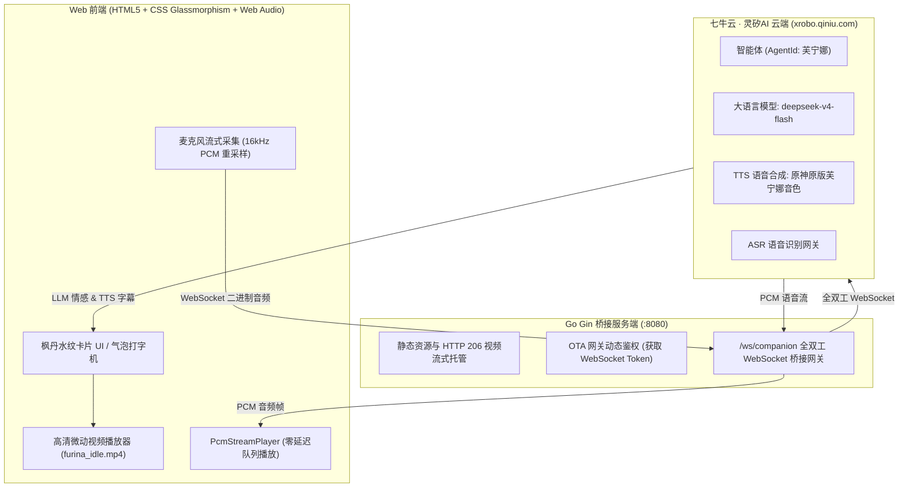

# 🎭 VoiceMate · 原神 AI 语音伴侣 (Web Edition)

> 基于 **Go (Gin)** + **七牛云「灵矽AI」平台** + **高清全视频驱动** 打造的轻量级、沉浸式原神 AI 桌面语音伴侣。首发支持枫丹水神 **芙宁娜（Furina）**。

---

## 🌟 核心特性 (Key Features)

1. **原神原版官方音色全双工语音对讲**：
   - 接入七牛云「灵矽AI」大模型网关（`deepseek-v4-flash`）与原生原神角色音色；
   - 支持**麦克风实时流式采集**与 **16kHz PCM 高保真语音流实时下行播报**，原汁原味还原角色声线。

2. **自研工业级高清全视频微动驱动**：
   - 弃用繁琐的 Live2D 骨骼拆解与实时音量口型开合；
   - 严格遵循「GPT-4o 高保真原画 $\rightarrow$ 可灵首尾闭环 100% 锁机位 $\rightarrow$ FFmpeg AMD CAS 自适应锐化与 2x 动作加速」标准化管线，保证发丝与线稿细腻度；
   - 前端通过正片叠底滤镜（`mix-blend-mode: multiply`）将白底自然消融在枫丹水纹拟态卡片中，呈现原生级通透视觉。

3. **双向情感与动作表情联动**：
   - 实时消费大模型情感信令标签（`happy` / `proud` / `embarrassed` / `thinking` / `angry`）；
   - 伴随说话动作自动微调微动播放速率（1.08x）。

4. **沉浸式交互与桌面悬浮支持**：
   - **部位触碰反应 (Hitboxes)**：摸摸礼帽（Head）、戳戳身躯（Body），触发专属水琴音效与傲娇台词；
   - **悬浮画中画（PiP）**：支持一键将芙宁娜缩小为独立置顶画中画小窗，跨窗口常驻桌面伴随工作。

---

## 🏗️ 技术架构 (Architecture)



---

## 🚀 快速启动 (Quick Start)

### 1. 环境准备
* **Go 1.20+**
* 现代浏览器（推荐 Google Chrome / Edge）

### 2. 启动服务
```bash
# 进入工程目录
cd VoiceMate

# 下载依赖
go mod download

# 启动 Gin 伴侣服务
go run main.go
```

启动成功后，在浏览器访问：
👉 **`http://localhost:8080`**

---

## 📂 目录结构

```text
VoiceMate/
├── main.go                     # Go Gin 服务端 (静态托管 + 视频分片流 + OTA WebSocket 代理)
├── go.mod / go.sum             # Go 模块依赖定义
└── static/
    ├── index.html              # 枫丹水神主题伴侣主页
    ├── css/style.css           # 玻璃拟态、水纹流光、Hitbox 交互样式
    ├── js/app.js               # 打字机字幕、麦克风流式采集、PCM 音效调度
    └── assets/
        └── videos/
            └── furina_idle.mp4 # 1080P Lanczos + CAS 锐化 2x 循环微动视频
```

---

## 👥 角色扩展路线 (Roadmap)
- [x] **芙宁娜（Furina）**：全视频微动驱动、原神原版音色、双向语音对讲、摸头互动
- [ ] **宵宫（Yoimiya）**：元气店长音色与微动短视频接入
- [ ] **克洛琳德（Clorinde）**：决斗代理人冷面微动与语音接入
- [ ] **桌面客户端打包**：基于 Tauri 封装免安装的透明桌面悬浮宠形态
